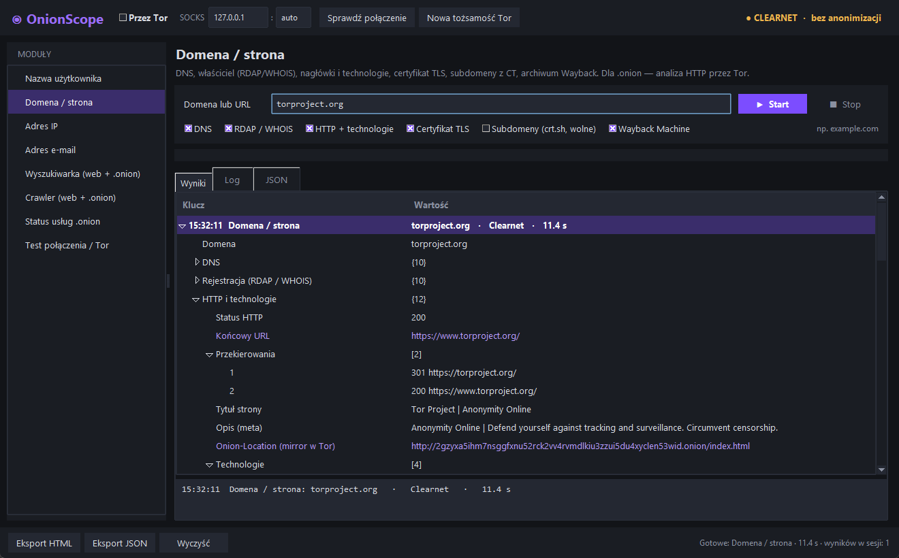

# OnionScope

**Narzędzie OSINT dla clearnetu i sieci Tor — w terminalu (CLI) i w oknie (GUI).**
*OSINT toolkit for the clear web and the Tor network, with a CLI and a Tkinter GUI (interface in Polish).*

  



Jeden przełącznik **Tor** kieruje *cały* ruch narzędzia — HTTP, DNS (DNS-over-HTTPS), WHOIS i TLS — przez
proxy SOCKS5h Tora. Nazwy hostów rozwiązuje Tor, więc nie ma wycieków DNS, a moduł `torcheck` sprawdza,
czy ruch naprawdę wychodzi przez sieć Tor.

## Funkcje

| Moduł      | Co robi |
|------------|---------|
| `user`     | Szuka nazwy użytkownika w ~40 serwisach (GitHub, GitLab, Reddit, Telegram, Mastodon, Bluesky, YouTube, Steam, Chess.com, Wikipedia…). Strony z ochroną anty-bot trafiają do „niepewnych”, a nie do fałszywych trafień. |
| `domain`   | DNS (A/AAAA/MX/NS/TXT/SOA/CAA, SPF, DMARC), właściciel z RDAP / WHOIS, technologie strony, nagłówki bezpieczeństwa, nagłówek **Onion-Location** (mirror w Tor), certyfikat TLS (także self-signed), subdomeny z Certificate Transparency, Wayback Machine. Dla `.onion` — analiza HTTP przez Tor. |
| `ip`       | Reverse DNS, geolokalizacja, właściciel sieci (RDAP), otwarte porty i CVE (Shodan InternetDB), czy adres jest **węzłem wyjściowym Tor**. |
| `email`    | MX / SPF / DMARC, dostawca poczty, skrzynki jednorazowe, Gravatar, klucze PGP (keys.openpgp.org, keyserver.ubuntu.com). |
| `search`   | **Ahmia** (wyszukiwarka usług .onion) oraz Bing / DuckDuckGo. |
| `crawl`    | Crawler stron, także `.onion`: e-maile, adresy .onion v3, portfele BTC / XMR / ETH (z walidacją sum kontrolnych), klucze PGP, Telegram, Discord, Session ID, Tox, XMPP, Matrix. |
| `onion`    | Weryfikuje sumę kontrolną adresów .onion v3 (wykrywa podróbki i literówki) i sprawdza, czy usługa odpowiada. |
| `torcheck` | Czy ruch idzie przez Tor, widoczny adres IP, stan lokalnych portów Tora. |
| `newnym`   | Nowa tożsamość Tor (`SIGNAL NEWNYM` przez port kontrolny, uwierzytelnianie cookie / safecookie / hasło). |

Wyniki można zapisać jako raport **HTML** albo **JSON**.

## Instalacja

Wymagany Python 3.10+ (Tkinter jest w standardowej instalacji na Windows i macOS;
na Linuksie zwykle pakiet `python3-tk`).

```bash
git clone <adres-repozytorium> onionscope
cd onionscope
pip install .
```

Po instalacji dostępne są komendy `onionscope` (CLI) i `onionscope-gui` (okno).
Bez instalacji: `pip install -r requirements.txt`, a potem `python osint.py` / `python osint_gui.pyw`.
Na Windows wystarczy dwuklik na `osint.bat` albo `start_gui.bat`.

### Tor

Wystarczy jedno z dwóch:

* **Tor Browser** — uruchom go i zostaw otwarty (SOCKS **9150**, port kontrolny 9151).
* **Usługa tor / Tor Expert Bundle** — SOCKS **9050**. Dla „Nowej tożsamości” dodaj w `torrc`
  `ControlPort 9051` i `CookieAuthentication 1`.

Port wykrywany jest automatycznie (9050, potem 9150); można go też podać ręcznie (`--tor-port`).

## GUI

```bash
onionscope-gui
```

* Zaznacz **Przez Tor** i kliknij **Sprawdź połączenie** — pasek u góry pokaże, czy ruch idzie przez Tor.
* Wybierz moduł, wpisz cel, naciśnij **Enter** albo **Start**; **Esc** przerywa.
* Wyniki są drzewem. Dwuklik na linku otwiera go (adres .onion kopiuje do schowka — otwórz w Tor Browser).
* Prawy przycisk na wartości → **Użyj jako cel w…** przenosi ją do innego modułu
  (np. e-mail → domena, wynik wyszukiwania → crawler).
* Zakładki **Log** i **JSON**, eksport całej sesji do HTML lub JSON.

## CLI

Uruchomienie bez argumentów (albo dwuklik na `osint.bat`) otwiera tryb interaktywny z promptem `osint>`:

```text
osint> user torvalds
osint> tor on
osint[tor]> search "tor project" --engine ahmia
osint> help domain
osint> exit
```

Pojedyncze wywołania:

```bash
onionscope user torvalds --only-found
onionscope domain example.com --subdomains -o raport.html
onionscope ip 185.220.101.1
onionscope email kontakt@example.com --json
onionscope search "ransomware" --engine ahmia --limit 20
onionscope --tor torcheck
onionscope --tor crawl http://<adres>.onion --depth 2 --max-pages 40 -o crawl.json
onionscope --tor onion <adres1>.onion <adres2>.onion
onionscope newnym
```

Opcje globalne (`--tor`, `--tor-host`, `--tor-port`, `--timeout`, `-o`, `--json`, `--no-color`) działają
przed i po komendzie. Każdy krok modułu można wyłączyć, np. `--no-whois`, `--no-tls`, `--no-gravatar`.
Pełna lista: `onionscope --help` i `onionscope <moduł> --help`.

## Struktura projektu

```text
onionscope/
  net.py         sesje clearnet / Tor (SOCKS5h), port kontrolny Tora, walidacja adresów .onion
  common.py      DNS-over-HTTPS, RDAP, WHOIS, wykonywanie równoległe
  extract.py     e-maile, adresy .onion, kryptowaluty, PGP, komunikatory
  report.py      wydruk w terminalu, raporty JSON / HTML
  modules/       user, domain, ip, email, search, crawl, onion, torcheck
  cli.py         interfejs wiersza poleceń i tryb interaktywny
  gui.py         interfejs graficzny (Tkinter)
osint.py, osint_gui.pyw, osint.bat, start_gui.bat   uruchamianie bez instalacji
```

### Własny moduł

Dodaj plik w `onionscope/modules/` z funkcją `run(net, target, log, **opcje) -> dict`
i wpis `Module(...)` w `onionscope/modules/__init__.py`. CLI i GUI same zbudują dla niego
komendę, opcje i formularz. Zapytania HTTP wykonuj przez `net.get()` / `net.fetch()`,
a połączenia TCP przez `net.connect()` — wtedy moduł automatycznie działa także przez Tor.

## Odpowiedzialne użycie

* OnionScope korzysta wyłącznie z publicznie dostępnych źródeł. Używaj go zgodnie z prawem
  i regulaminami serwisów — do badań, dziennikarstwa, threat intelligence, testów własnej infrastruktury.
* Przez Tor część serwisów (Cloudflare, Reddit…) blokuje ruch; takie wyniki są oznaczane jako niepewne.
  Pomaga „Nowa tożsamość” albo sprawdzenie w trybie clearnet.
* Na stronach `.onion` można trafić na nielegalne treści. Crawler pobiera tylko tekst i HTML
  (pomija obrazy i pliki binarne), ale zachowaj ostrożność.

## Licencja

[MIT](LICENSE)
